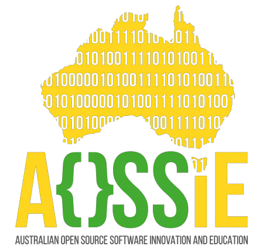

<!-- Don't delete it -->

<!-- Organization Logo -->

  
  

&nbsp;

<!-- Organization Name -->

<!-- Correct deployed url to be added -->

<!-- Organization/Project Social Handles -->

<!-- Telegram -->

&nbsp;&nbsp;
<!-- X (formerly Twitter) -->

&nbsp;&nbsp;
<!-- Discord -->

&nbsp;&nbsp;
<!-- Medium -->

&nbsp;&nbsp;
<!-- LinkedIn -->

&nbsp;&nbsp;
<!-- Youtube -->

---

<h1>CodingAgent</h1>

[CodingAgent](https://github.com/AOSSIE-Org/CodingAgent) is an open-source, CLI-based AI coding agent that works like the best closed-source tools — Claude Code, Codex, and Antigravity — but without the vendor lock-in. It supports any LLM (cloud or local), persists memory across sessions, integrates natively with Git and MCP servers, and stays lightweight enough for real engineering workflows.

---

## 🚀 Features

- **Model Agnostic LLM Support**: Works with any LLM out of the box — Claude, GPT, Gemini, Ollama local models, Kimi — switched via a single config line with no code changes required.
- **Persistent Multi-Tier Memory**: Three-tier memory system (short-term buffer, long-term local vector store, per-project `AGENT.md` scratchpad) that survives session resets and context limits — the agent remembers decisions, patterns, and past bugs.
- **Reliable Agent Loop with File & Shell Tools**: A clean goal → plan → execute → observe loop with native file read/write, shell command execution, and automatic error recovery — no bloated orchestration framework, just a tight and predictable core loop.
- **MCP Integration**: First-class Model Context Protocol support so users can plug in GitHub, databases, documentation, or any custom tool server via a simple config entry — no core code changes needed.
- **Optimised Context & File Caching**: Files already read in a session are cached and not re-fetched unless modified — drastically cuts token usage and API costs across long sessions.
- **User-Editable Prompt Profile**: A simple `profile.md` where users describe their tech stack, coding style, and preferences — the agent reads this on every session startup and codes exactly the way you like.
- **Git Integration**: Native Git awareness — reads commit history and diffs so the agent understands what changed recently and makes smarter, context-aware suggestions over time.
- **Commit-Level Code Review**: On-demand security and quality review for any commit or staged diff — lists vulnerabilities, code smells, and risky changes as a clean CLI report when explicitly asked.

---

## 💻 Tech Stack

### CLI & Runtime
- TypeScript
- Commander.js (argument parsing)
- Inquirer (interactive terminal prompts)

### Backend / Core Agent
- Node.js
- Execa (safe async shell execution)
- Ripgrep + Glob (fast codebase file navigation)
- Simple Git (native Git integration — diffs, history, commits)

### Database & Memory
- SQLite (local persistent storage, zero external services)
- sqlite-vec (vector search extension for semantic memory)
- In-memory JSON ring buffer (short-term session context)

### AI/ML
- Vercel AI SDK (provider-agnostic LLM routing)
- Google Gemini / OpenAI GPT / Anthropic Claude / Ollama / Kimi
- Model Context Protocol SDK (MCP tool + server connections)
- Custom token budget manager + auto-compaction engine
- RAG over local codebase / user prompt profile engineering

### Tooling & Build
- tsup (TypeScript bundler)
- tsx (zero-config TypeScript dev runner)
- Vitest (unit and integration testing)
- ESLint + Prettier (code quality and formatting)
- SWE-bench (agent performance benchmarking)

---

## ✅ Project Checklist

- [ ] **The CLI Agent (core)**:
   - [ ] Agent loop (goal → plan → execute → observe) is implemented and documented.
   - [ ] Works end-to-end with at least one local model (Ollama) and one cloud model (Claude/GPT).
   - [ ] Installable via `npx codingagent` with zero manual setup.

- [ ] **Multi-LLM Support**:
   - [ ] Provider-agnostic LLM routing implemented and tested across Claude, OpenAI, Gemini, and Ollama.
   - [ ] Model switching works via single config change with no code modification.
   - [ ] Streaming responses work correctly across all supported providers.

- [ ] **Memory System**:
   - [ ] Short-term in-session buffer implemented with token cap.
   - [ ] Long-term SQLite vector store persists across sessions.
   - [ ] Per-project `AGENT.md` scratchpad is read and written by the agent automatically.
   - [ ] File caching prevents re-reading unchanged files within a session.

- [ ] **Context & Cost Optimisation**:
   - [ ] Token budget manager tracks and allocates context per turn.
   - [ ] Auto-compaction triggers when context hits 80% of model limit.
   - [ ] User-editable `profile.md` for tech stack and coding style preferences is loaded on every session.

- [ ] **MCP Integration**:
   - [ ] MCP client connects to at least GitHub and one custom tool server.
   - [ ] New MCP servers can be added via config with no code changes.

- [ ] **Git Integration**:
   - [ ] Agent reads commit history and diffs natively.
   - [ ] On-demand commit-level code review lists vulnerabilities and risky changes in CLI.

- [ ] **The AI/ML components**:
   - [ ] LLM model selection and configuration are documented.
   - [ ] System prompt and user `profile.md` are version-controlled.
   - [ ] API keys are stored securely in local config, never hardcoded.
   - [ ] Rate limit handling and retry logic implemented for all providers.

- [ ] **Quality & Open Source**:
   - [ ] Test coverage for core agent loop, memory, and tool execution.
   - [ ] Benchmarked against SWE-bench or equivalent to prove quality.
   - [ ] Contributing guide and onboarding docs published in repo.

---

## 🔗 Repository Links

1. [Main Repository](https://github.com/AOSSIE-Org/CodingAgent)
2. [GSoC 2026 Idea](https://github.com/AOSSIE-Org/Info/blob/main/GSoC-Ideas/2026/CodingAgent.md)
3. [GSoC 2026 Index](https://github.com/AOSSIE-Org/Info/blob/main/GSoC-Ideas/2026/index.md)

---

## 🏗️ Architecture Diagram

---

## 🔄 User Flow

---

## �🍀 Getting Started

To be added.

---

## 📱 App Screenshots

To be added.

---

## 🙌 Contributing

⭐ Don't forget to star this repository if you find it useful! ⭐

Thank you for considering contributing to this project! Contributions are highly appreciated and welcomed. To ensure smooth collaboration, please refer to our [Contribution Guidelines](./CONTRIBUTING.md).

---

## ✨ Maintainers
- [Himanshu Poptani](https://github.com/coderwithsense)

---

## 📍 License

This project is licensed under the GNU General Public License v3.0.
See the [LICENSE](LICENSE) file for details.

---

## 💪 Thanks To All Contributors

Thanks a lot for spending your time helping CodingAgent grow. Keep rocking 🥂

© 2026 AOSSIE 
